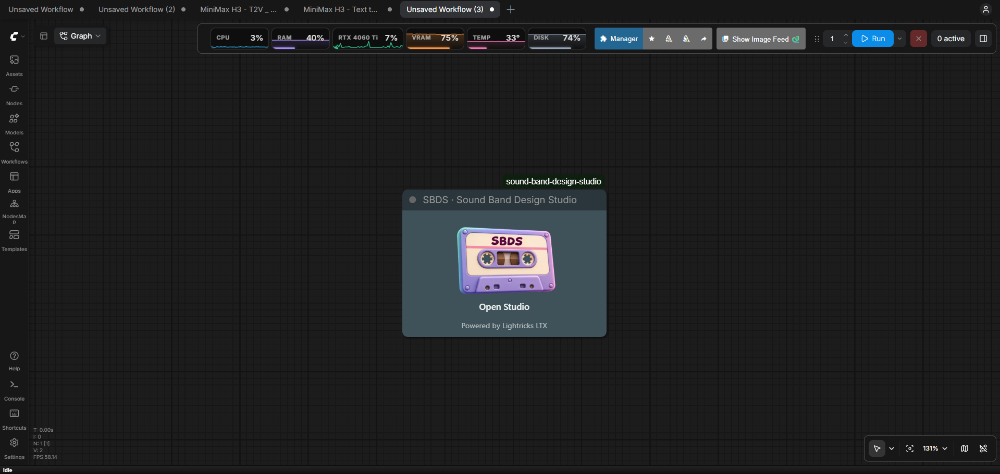
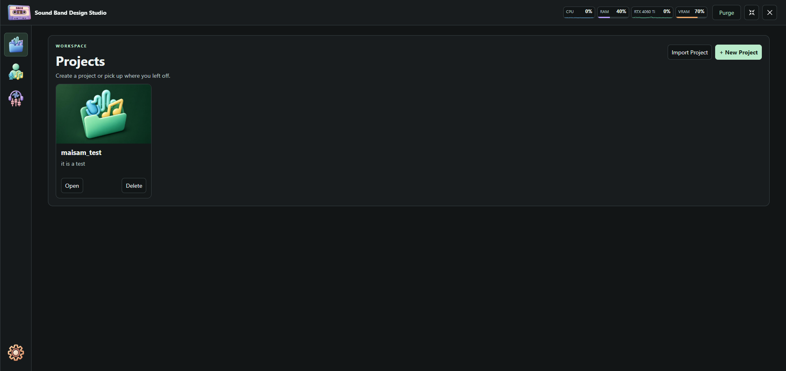
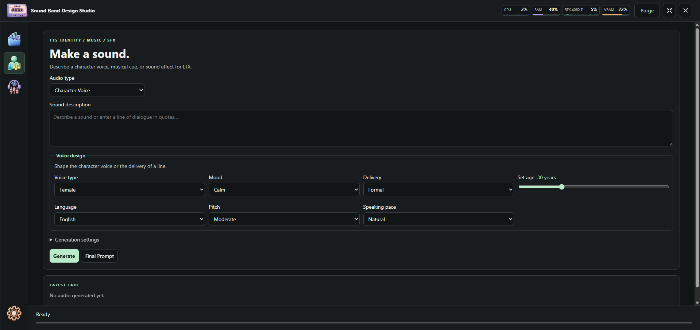
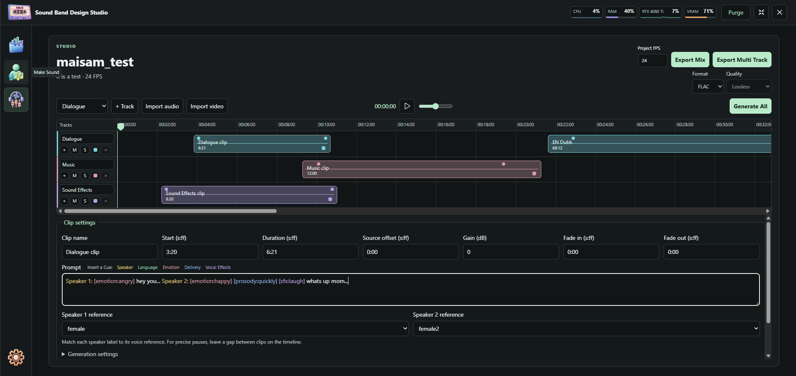
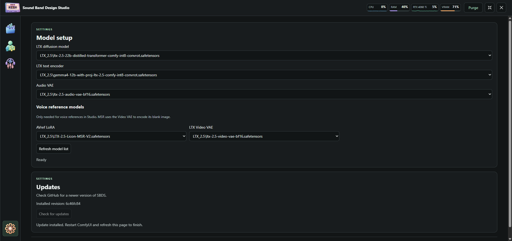
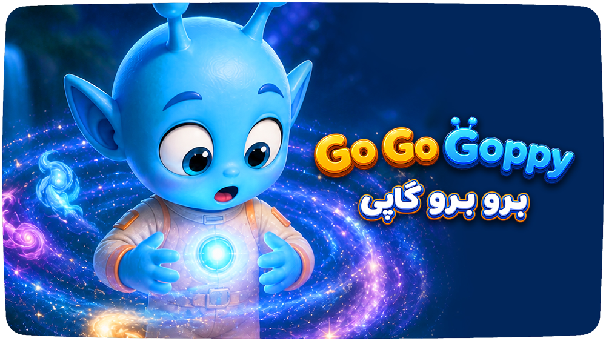

<p align="center">
  
</p>

<h1 align="center">Sound Band Design Studio</h1>

<p align="center"><strong>Generate, edit, and mix sound inside ComfyUI.</strong></p>

SBDS is a local audio production workspace powered by Lightricks LTX. Create dialogue, music, and sound effects from prompts, organize takes in a project, and build a soundtrack on a frame-based timeline. Import a video as a picture reference to edit a dub or assemble new sound against the original footage.

<p align="center"></p>

## Installation

Install [ComfyUI](https://docs.comfy.org/installation), then clone these repositories into its `custom_nodes` directory. If you already have the LTX pack, use that installation and its Python dependencies.

```sh
git clone https://github.com/maisamh80/ComfyUI-SBDS.git
git clone https://github.com/Lightricks/ComfyUI-LTXVideo.git
```

[ComfyUI-LTXVideo](https://github.com/Lightricks/ComfyUI-LTXVideo) supplies the LTX audio-only nodes. For a manual install, install its requirements with the Python environment that runs ComfyUI. [ComfyUI-LTX2.5-MSR](https://github.com/liconstudio/ComfyUI-LTX2.5-MSR) is the second, optional custom node pack. Install it in the same directory if you want to generate dialogue with voice references. SBDS itself has no separate pip or npm installation.

### Models and where they go

The following filenames are examples for the LTX 2.5 model stack. Select the matching files installed on your system. [LTX Text-to-Audio model files](https://docs.ltx.io/open-source-model/usage-guides/text-to-audio/) · [LTX Video VAE](https://docs.ltx.io/open-source-model/usage-guides/text-to-video#model-files) · [MSR reference setup](https://github.com/liconstudio/ComfyUI-LTX2.5-MSR/blob/main/README-AVref.md)

| Use | Model | ComfyUI folder |
| --- | --- | --- |
| Base generation | LTX 2.5 distilled transformer, e.g. `ltx-2.5-22b-distilled-transformer-bf16.safetensors` | `models/diffusion_models/` |
| Base generation | Gemma text encoder with LTX projection, e.g. `gemma4-12b-with-proj-ltx-2.5-bf16.safetensors` | `models/text_encoders/` |
| Base generation | LTX 2.5 Audio VAE, e.g. `ltx-2.5-audio-vae-bf16.safetensors` | `models/vae/` |
| Voice references | LTX 2.5 Video VAE, e.g. `ltx-2.5-video-vae-bf16.safetensors` | `models/vae/` |
| Voice references | MSR-compatible **AVref LoRA** with audio reference weights, e.g. `LTX-2.5-Licon-MSR-V2.safetensors` | `models/loras/` |

Restart ComfyUI after installation. In the local ComfyUI interface, add **SBDS · Sound Band Design Studio** to the canvas and select **Open Studio**. Use **Settings → Model setup** to select the transformer, text encoder, and Audio VAE. For referenced dialogue, select the separate Video VAE and AVref LoRA under **Voice reference models**. Importing a video for preview uses neither of those reference models.

---

<p align="center"></p>

<h2 align="center">Projects</h2>

Projects is the library for work in progress and finished soundtracks. Each project has a name, a thumbnail, and a local folder containing `project.json` and four subfolders: `assets/`, `cache/`, `prompts/`, and `exports/`. Studio saves the timeline, clip settings, and prompts with the project.

Copy the entire project folder to move it to another ComfyUI installation, then use **Import Project** to register its new location. Deleting a project card removes it from the library while keeping its folder on disk.

<p align="center"></p>

---

<p align="center"></p>

<h2 align="center">Make Sound</h2>

Make Sound generates standalone takes from a description or a line of dialogue. Choose **Character Voice**, **Music**, or **Sound Effect**. Voice design controls age, voice type, mood, language, pitch, pace, and delivery. **Final Prompt** shows the text sent to LTX and lets you edit it before generating.

Preview the latest take in SBDS, download it as FLAC, WAV, MP3, or Opus, or use **Add to Library** to keep it with a project. Saved takes can serve as voice references in Studio. ComfyUI keeps the original FLAC under `output/audio/SBDS/`.

<p align="center"></p>

---

<p align="center"></p>

<h2 align="center">Studio</h2>

Studio brings dialogue, music, and sound effects together on a multitrack timeline. Import existing audio or generate clips in place. The timeline snaps to the project frame rate, and its playhead can move one frame at a time. Clips support trimming, source offsets, gain, and fades. Tracks support color, mute, and solo.

- **Dialogue and voice references.** Match speaker labels to up to two optional reference recordings. Dialogue cues describe language, emotion, delivery, and vocal effects for the following line. **Final Prompt** shows the dialogue and reference labels that will be sent to LTX. Place clips apart on the timeline for exact pauses.
- **Takes and revisions.** Generate an individual clip or queue the remaining ungenerated clips with **Generate All**. **Generate Again** reopens a clip's prompt and settings while its previous take remains available. The last seed is shown so you can reuse it.
- **Dubbing and soundtracks for video.** **Import video** adds one H.264 MP4 or WebM reference from frame zero. Its picture follows playback and seeking, and its original sound can be muted or soloed for comparison. Edit replacement dialogue, music, and effects against the picture. SBDS exports the finished audio for use with the video in your editor.
- **Export.** **Export Mix** renders a stereo mix. **Export Multi Track** creates a ZIP of time-aligned tracks. Both save to `exports/` and support FLAC, WAV, MP3, and Opus at the selected quality. Audio exports reflect the timeline edits, gain, fades, and audio track mute or solo. Reference video audio is available for monitoring.

<p align="center"></p>

---

<p align="center"></p>

<h2 align="center">Settings</h2>

Settings connects SBDS to the model files already available in ComfyUI. **Model setup** covers the transformer, text encoder, and Audio VAE for base generation. **Voice reference models** adds the AVref LoRA and Video VAE for referenced dialogue. SBDS uses the Audio VAE to encode the reference recordings and supplies the blank guide images that MSR requires.

**Updates** checks GitHub for new SBDS revisions. For a Git installation on `main`, **Update now** fast-forwards to the checked revision. Restart ComfyUI and refresh the browser after updating.

The workspace header shows ComfyUI server CPU and RAM usage, plus NVIDIA GPU and VRAM usage when available. **Purge** requests that ComfyUI unload its models and clear its execution cache.

<p align="center"></p>

---

## Made by this workflow

I created the voices in this video using this ComfyUI workflow.

<p align="center">
  <a href="https://www.youtube.com/watch?v=xAV3ux7SqSI"></a>
</p>

<p align="center"><a href="https://www.youtube.com/watch?v=xAV3ux7SqSI">Watch the voice demo on YouTube</a></p>

---

## Credits and license

Developed by **Maisam Hosaini**. [StoryEco.xyz](https://storyeco.xyz/)

Powered by **Lightricks LTX**. SBDS is released under the [MIT License](LICENSE). Upstream nodes and model weights have their own terms.
