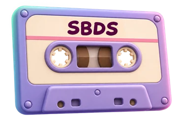

# Sound Band Design Studio (SBDS)



An LTX-powered audio production studio inside ComfyUI. This first checkpoint provides the canvas launcher, model setup, and an audio-only generation panel. You can queue a take, follow sampling progress, listen, and download the result.

## Install on a fresh ComfyUI

1. Install and start a current [ComfyUI](https://docs.comfy.org/installation). Use the ComfyUI user data directory if your installation keeps custom nodes outside the application directory.
2. In its `custom_nodes` directory, install SBDS and the upstream LTX node pack:

   ```sh
   git clone https://github.com/maisamh80/ComfyUI-SBDS.git
   git clone https://github.com/Lightricks/ComfyUI-LTXVideo.git
   ```

   If the LTX pack is already installed, use that copy. Install its dependencies with the Python environment used by ComfyUI, or install it through ComfyUI Manager. For a manual install, run `python -m pip install -r ComfyUI-LTXVideo/requirements.txt` from `custom_nodes` using ComfyUI's Python.

3. Install a matching LTX 2.5 distilled diffusion model, LTX text encoder, and Audio VAE in the folders below. Follow the [upstream Text-to-Audio guide](https://docs.ltx.io/open-source-model/usage-guides/text-to-audio/) for compatible downloads and filenames.

   | ComfyUI model folder | Component |
   | --- | --- |
   | `models/diffusion_models/` | LTX 2.5 distilled transformer |
   | `models/text_encoders/` | LTX 2.5 Gemma text encoder with projection |
   | `models/vae/` | LTX 2.5 Audio VAE |

4. Restart ComfyUI and refresh the browser. Add **SBDS · Sound Band Design Studio** and click **Open Studio**. The studio opens on **Projects**. Open **Settings → Model setup** from the sidebar to verify the model files.

SBDS itself has no extra pip or npm dependencies. Model weights stay in your ComfyUI installation. Use an appropriate quantization and the ComfyUI memory settings for your hardware. The development workflow uses an INT8 transformer and text encoder. Start with a short sample when testing a new installation.

## Update SBDS

In a Git installation on the `main` branch, open **Settings → Updates** and select **Check for updates**, then **Update now** when offered. SBDS fast-forwards to the checked GitHub revision and keeps your project folders and local edits. Restart ComfyUI and refresh the browser after the update.

## First smoke run

1. Open **Identity** in the sidebar, select **Sound Effect**, and try “A soft, steady rain patters on leaves in a forest. No thunder or speech.”
2. Under **Generation settings**, keep the duration at 5 seconds, Generation FPS at 24, 8 steps, `uni_pc`, `simple`, and CFG 1.
3. Click **Generate**. Check the progress bar and elapsed time, then play the take. Choose a **Format** and **Quality** beside the player and click **Download**. SBDS exports FLAC, WAV, MP3, or Opus from the same take. ComfyUI stores the original FLAC under `output/audio/SBDS/`.

The model FPS and target seconds determine the latent frame count. They are separate from the decoded audio sample rate. At CFG 1, the default guider may ignore the negative prompt.

Click **Purge** in the header to request that ComfyUI unload its models and clear its execution cache. Generating a take does not request cleanup, so ComfyUI can reuse loaded models between takes. The header shows the server's CPU and RAM usage, plus NVIDIA GPU and VRAM usage when `nvidia-smi` is available on the server.

For a voice, enter a description or a line in quotation marks and choose its traits under **Voice design**. **Final Prompt** shows the text that will be sent to LTX. Saved edits apply to that generated prompt in this browser. Use **Reset to generated** and save to clear the edit. Choose **Custom** in the language menu to enter a language by name.

## Projects

Open SBDS from local ComfyUI (`localhost` or `127.0.0.1`). **New Project** creates a named folder in the location you select. It contains `project.json` and four folders: `assets/`, `cache/`, `prompts/`, and `exports/`. The project thumbnail is stored in `cache/`. ComfyUI keeps the list of project locations in its user data.

Move or copy the entire folder to take a project to another installation. **Import Project** registers the folder containing `project.json`. Importing another copy of a project points its existing card at the selected location. **Delete** removes the card from the library and keeps the folder on disk.

## Studio

Open a project, then use **Studio** to arrange Dialogue, Music and Sound Effects tracks. Add clips at the playhead, import audio, or select a saved asset. Drag clips and their edges to edit timing, use the dots for fades, and drag the line to adjust gain. Track and clip colors, mute, solo, and project FPS are saved with the project. Timeline edits and prompts are stored in `prompts/studio.json`.

For generated clips, enter a prompt and use **Generate clip** or **Generate all**. For dialogue, enter the words to speak and add cues with the menu; a cue such as `[pause:3s]` inserts three seconds of silence. Use Speaker 1 and Speaker 2 to distinguish lines when using two voice references. LTX interprets the language, emotion, delivery, and vocal effect cues from the prompt.

Text-to-audio uses the existing LTX node pack. Optional voice references also require [ComfyUI-LTX2.5-MSR](https://github.com/liconstudio/ComfyUI-LTX2.5-MSR), a compatible AVref LoRA, and the LTX video VAE. Studio provides the blank images required by MSR automatically. A missing speaker slot is skipped; clips with no references use the regular audio generation path.

**Export mix** saves a stereo WAV in `exports/`. **Export stems** saves a ZIP of time-aligned WAV tracks. Both respect mute and solo and include edits, gain, and fades.

## License

The SBDS code uses the MIT license. Upstream node packs and model weights have their own terms.
